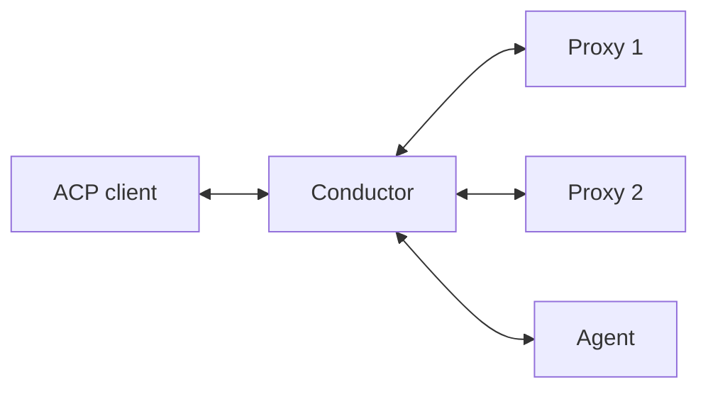

# Conductor Design

The `agent-client-protocol-conductor` crate runs a chain of ACP proxy
components. It presents one ACP endpoint upstream while owning the connections
to every proxy and, in agent mode, the final agent.

For API details, see the
[`agent-client-protocol-conductor` rustdoc](https://docs.rs/agent-client-protocol-conductor).

## Chain Model



Components do not open direct connections to one another. The conductor owns
each transport and maps the logical chain onto those connections:

- Upstream traffic is delivered to the first proxy as ordinary ACP messages.
- A proxy uses `proxy/successor` to send a request or notification to the next
  component.
- Traffic from a successor is presented to its predecessor through the same
  typed proxy abstraction.
- JSON-RPC responses remain paired with the request context that caused them.

The final agent receives ordinary ACP and does not need to implement the proxy
extension. See the [Proxy Extension Protocol Reference](./protocol.md) for the
wire method shapes. The conductor uses `proxy/initialize` and `proxy/successor`
from the ACP proxy chains RFD; earlier releases used `_proxy/initialize` and
`_proxy/successor`, so upgrade conductors and proxies together (see
[Migrating Proxy Method Names](./migration-proxy-methods.md)).

## Lazy Initialization

Proxy and agent components are instantiated when the first `initialize`
request arrives. For each non-final component, the conductor sends
`proxy/initialize`; the last component in agent mode receives ordinary
`initialize`. Each proxy can initialize its successor before completing its own
response, so capabilities flow back toward the client through the chain.

Lazy construction allows an `InstantiateProxiesAndAgent` or
`InstantiateProxies` implementation to inspect and, when appropriate, adjust
the initialize request before choosing components.

Initialization selects the protocol version from the raw `protocolVersion`
before deserialization, so v2 `info`, `capabilities`, metadata, and future
extension fields are never interpreted as a permissive v1 request. With the
conductor crate's `unstable_protocol_v2` feature, a request for v2 or newer
selects v2; every other request selects v1, keeping v1's fallback-to-latest
rule. A request for a newer version than the selected one keeps only what
parses under the selected version. A conductor in proxy mode accepts exactly
the version its own conductor selected. The instantiator receives a
`SelectedInitializeRequest` for the selected version. An unchanged request for
exactly the selected version keeps its original raw parameters, including
unknown extensions; a modified typed request is serialized as the new
authoritative payload, while its `protocolVersion` remains pinned to the
selected version.

The command-line component provider, `AgentOnly`, `ProxiesAndAgent`, and static
proxy vectors use their components for every version, so each supplied
component must support the selected version. Use `Agent.protocol_router()` or
`Proxy.protocol_router()` when a static component has separate
implementations. A custom instantiator rejects a version it does not support
(for example with `SelectedInitializeRequest::into_v1`); the error answers the
`initialize` request and leaves the connection in a failed state that rejects
later traffic. A first message that is not a valid initialization is answered
with an error and leaves the conductor uninitialized, so the client can retry.

## Forwarding

Forwarding is the same for every protocol version and does not depend on the
feature: `proxy/initialize` has the same wire shape in v1 and v2. The
conductor rejects a `proxy/initialize` that arrives from outside, renames
`initialize` to `proxy/initialize` for the first proxy with its params
untouched, and forwards everything else unchanged, without parsing or
re-serializing it. The conductor's connections to its client and to the final
agent, and the pass-through proxy it inserts for tracing, have no protocol
version guard; the endpoints validate the traffic of the selected version.

## Agent and Proxy Modes

In **agent mode**, the conductor owns zero or more proxies followed by a final
agent and acts as an agent toward its upstream client.

In **proxy mode**, the conductor owns only a proxy sub-chain. The final managed
proxy's successor is the conductor's own downstream successor, allowing a
sub-chain to participate as one proxy inside a larger composition.

## Routing and Ordering

A central routing loop serializes forwarding decisions for incoming requests
and notifications. Responses are associated with their original requests by
the core JSON-RPC contexts and may use a direct response path; the conductor
does not maintain a second global request-ID table.

Every physical and in-process bridge carries `TransportFrame`, so tracing and
delegating components relay each wire value, including malformed input,
unchanged. JSON-RPC batches are not supported; see [Transport
Architecture](./transport-architecture.md#json-rpc-batches).

## Command-Line Usage

Global options precede the subcommand. Each component argument is one
shell-parsed command string, so quote commands that include arguments:

```bash
agent-client-protocol-conductor agent \
  "proxy-one --flag" \
  "proxy-two" \
  "base-agent --acp"
```

The last command in `agent` mode is the agent; earlier commands are proxies.
Proxy mode accepts only proxy commands:

```bash
agent-client-protocol-conductor proxy "proxy-one" "proxy-two"
```

Tracing options are global:

```bash
agent-client-protocol-conductor --trace ./trace.jsons agent "proxy-one" "base-agent"
agent-client-protocol-conductor --serve agent "proxy-one" "base-agent"
agent-client-protocol-conductor --trace ./trace.jsons --serve agent "proxy-one" "base-agent"
```

Build the opt-in binary with draft-v2 proxy initialization enabled using:

```bash
cargo build -p agent-client-protocol-conductor --features unstable_protocol_v2
```

There is no conductor `mcp` subcommand. Compatibility for HTTP-capable agents that lack the
native ACP MCP transport lives in `agent-client-protocol-polyfill` and must
be inserted explicitly when needed.

## Programmatic Usage

```rust,ignore
use agent_client_protocol_conductor::{ConductorImpl, ProxiesAndAgent};

let components = ProxiesAndAgent::new(agent)
    .proxy(first_proxy)
    .proxy(second_proxy);

ConductorImpl::new_agent("conductor", components)
    .run(upstream_transport)
    .await?;
```

`ConductorImpl::new_proxy` accepts an `InstantiateProxies` implementation for
the nested-proxy case. Both modes can use dynamic instantiator closures that
receive the `SelectedInitializeRequest` when the chain depends on
initialization data.

## MCP Compatibility

MCP-over-ACP adaptation is intentionally not built into `ConductorImpl`. Add
`McpOverAcpPolyfill::http()` as a proxy in the chain immediately before a final
agent that cannot consume native `McpServer::Acp` declarations. The
provider-facing side uses feature-gated, request-scoped `mcp/message`
operations for MCP 2026-07-28; only the final-agent side is adapted to HTTP.
Keeping the polyfill explicit prevents instrumentation or
orchestration from silently changing session MCP declarations. See [MCP
Bridge](./mcp-bridge.md).

The polyfill supports v1 by default. For a draft-v2 chain, enable
`unstable_protocol_v2` on both the conductor and polyfill crates; without the
polyfill feature, it rejects v2 initialization instead of interpreting v2
traffic as v1.

## Tracing

The conductor can record an idealized logical sequence of ACP and MCP messages.
Its snooping bridges retain complete transport frames, so enabling tracing does
not change what is sent on the wire. See [Trace Viewer](./trace-viewer.md) for the event
format and current CLI/API examples.
